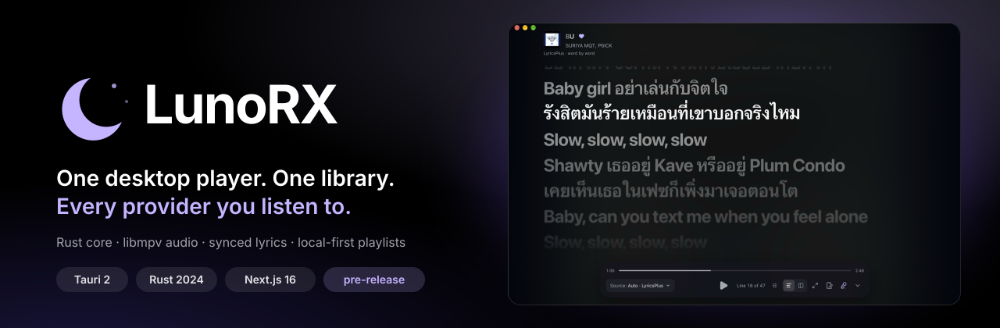
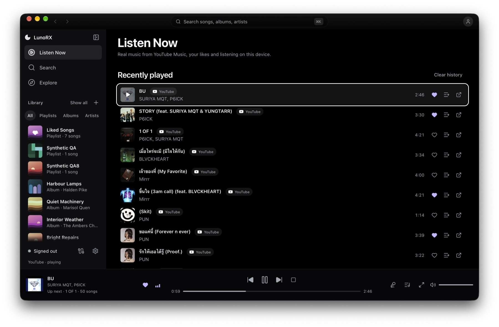
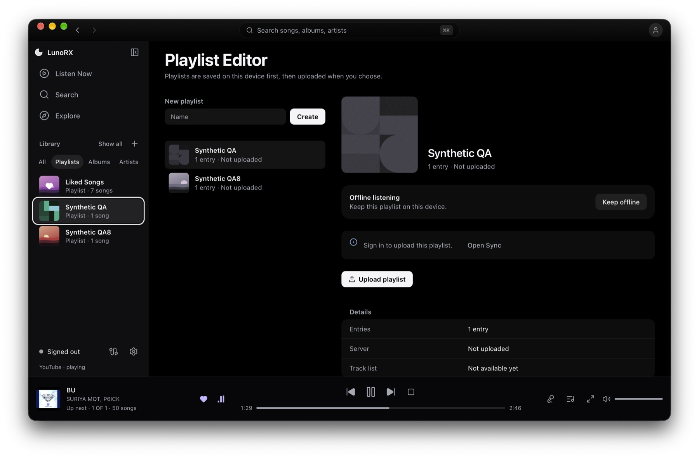
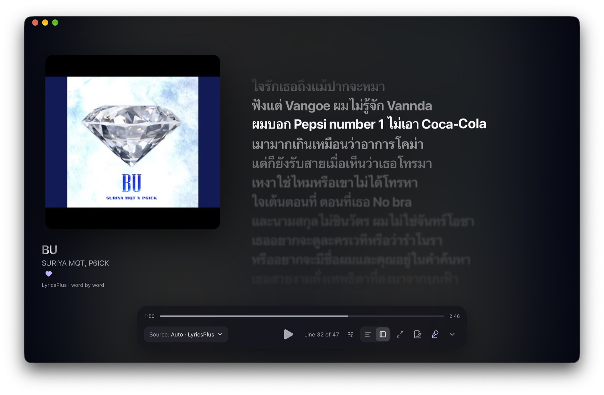

<div align="center">



# LunoRX

**One desktop player. One library. Every provider you listen to.**

A Tauri 2 desktop music player with a Rust core that owns search, playback, queue and sync,
and a dark glass interface that only ever shows what the core can actually do.

`Tauri 2` · `Rust (edition 2024)` · `Next.js 16 static export` · `React 19` · `libmpv` · `macOS first, Windows and Linux supported`

</div>

---

> **Status: pre-release (`1.0.0-rc.0`).** It plays real YouTube audio on a developer machine. Spotify playback and search are not supported. No installer has been verified on a clean machine yet. [What works, what does not](#status-the-honest-version) is spelled out below, because a README that overstates is worse than none.

> [!IMPORTANT]
> ### ⚠️ Disclaimer
>
> **No affiliation.** LunoRX and its contributors are not affiliated with, authorized by, endorsed by, or in any way officially connected with Google LLC, YouTube, YouTube Music, Spotify AB, or any of their subsidiaries or affiliates, nor with the lyric services it can query (LRCLIB, LyricsPlus, Netease Cloud Music, QQ Music, Kugou, Boidu). This is an independent, unofficial, open-source project.
>
> **Trademarks.** "Google", "YouTube", "YouTube Music", "Spotify" and all related names, marks, emblems and images are registered trademarks of their respective owners. They are used here only for identification and reference and do not imply any association with, or endorsement by, the trademark holders. There is no intention to infringe on these trademarks or to harm their owners.
>
> **Third-party services.** The app reaches YouTube Music directly and, for lyrics, several unofficial endpoints. These services have their own terms, and they may change, restrict or stop working at any time without notice. You are responsible for using the app in a way that complies with the terms that apply to you. See [Security model](#security-model) and [Lyrics](#lyrics) for exactly what is sent where.
>
> **Limitation of liability.** The software is provided **"AS IS"**, without warranty of any kind, and you use it at your own risk. In no event shall the authors or contributors be liable for any claim, damages or other liability, including any legal consequences, whether in an action of contract, tort or otherwise, arising from, out of or in connection with the software or the use of or other dealings in it. The responsibility for any outcome of using this software rests entirely with the user. The [MIT licence](LICENSE) governs the code in this repository.

## Contents

- [What it is](#what-it-is)
- [Screenshots](#screenshots)
- [Features](#features)
- [Status, the honest version](#status-the-honest-version)
- [Quick start](#quick-start)
- [Develop in a plain browser (dev mock)](#develop-in-a-plain-browser-dev-mock)
- [Architecture](#architecture)
- [Repository layout](#repository-layout)
- [The IPC surface](#the-ipc-surface)
- [Playback pipeline](#playback-pipeline)
- [Lyrics](#lyrics)
- [Security model](#security-model)
- [Design system](#design-system)
- [Keyboard shortcuts](#keyboard-shortcuts)
- [Quality gates and tests](#quality-gates-and-tests)
- [Releasing](#releasing)
- [Known limits](#known-limits)
- [Project documents](#project-documents)

## Screenshots

<table>
  <tr>
    <td width="50%"><br><sub><b>Listen Now.</b> History, your library in the sidebar, the player bar with the real up-next queue.</sub></td>
    <td width="50%"><br><sub><b>Playlist Editor.</b> Playlists live on this device first; keep offline, upload when you choose.</sub></td>
  </tr>
  <tr>
    <td width="50%"><br><sub><b>Full-window lyrics.</b> Word-by-word highlight from LyricsPlus, source picker and line counter.</sub></td>
    <td width="50%"><br><sub><b>Split lyrics.</b> Cover and track details beside the lyrics.</sub></td>
  </tr>
</table>

Full-size originals are in [`assets/`](assets/). The images show the app running on macOS with real YouTube Music data.

## What it is

LunoRX is a desktop-first unified music player. The idea is simple and strict:

> **One Application. One Library. Multiple Providers. Full User Control.**

Playlists mix tracks from different providers in one place, and every entry always says where it comes from. Your data lives on your machine first. An optional, self-hostable backend syncs playlists between devices; the app works fully without it.

Three rules shape every decision in this codebase:

1. **Honest capabilities.** A capability is "supported" only when it was verified. Unknown means unsupported. A track is `PLAYING` only after the player confirms it, never because a Play command was sent.
2. **The core is the source of truth.** Search, playback state, the queue and sync live in Rust. The React UI renders state and sends intent. It never keeps a second copy of the queue or invents a playback state.
3. **Two separate auth worlds.** App sign-in (the sync backend) and provider sign-in (YouTube) never mix. Provider credentials stay in the OS key store on this machine and are never sent anywhere else.

## Features

**Listen**
- Native audio through **libmpv**: seek, volume, stop, resume where you left off, loudness and stream-quality settings, PCM format and sample rate.
- **Autoplay radio**: when a track ends, the core prepares the next related track ahead of time and plays it. The up-next list is real, selectable, and feeds the Previous button.
- **Play an album or an artist's songs in order**: Play, Shuffle and Save to playlist from any album or artist page. The core queues the rest as Up next.
- **macOS integration**: Now Playing widget, media keys, and a Playback menu in the menu bar.
- **Offline**: keep a playlist on this device; a disk cache with a size limit manages the rest.

**Find**
- **Home** (history and recommendations), **Explore** (Discover, Thai music, Pop, Hip-hop, Focus, Chill, Acoustic), **Search** with live suggestions and cancellation of obsolete searches.
- **Library**: liked songs, artists (with profile photos), albums, and local playlists.
- **Artist and album pages** with real profiles, discography and track lists.
- A **command palette** (`⌘K` / `Ctrl+K`) for search and navigation.

**Lyrics**
- Time-synced lyrics with a full-window layout, an active line, intro and instrumental gaps, and click-to-seek.
- **Eight lyric sources** with an Auto order you control: LyricsPlus, LRCLIB, YouTube Music, Netease, QQ Music, Kugou, Boidu, plus your own files. Real **word-by-word** timing where a source provides it; a clearly labelled *guessed* mode where it does not.
- **Source picker**, per-source **timing offset**, and **Wrong song? Search by title** with a manual bind.
- **Lyric Maker**: play a song and type or tap along to write a `.lrc` file with timestamps, with a calibration pass to measure your input delay. Files are plain text in `~/Documents/LUNOR-X Lyrics/`.

**Own your data**
- Local-first playlists with an **offline queue**, **optimistic concurrency** (version numbers) and **explicit conflict resolution**: keep mine or keep the server's. Nothing is overwritten silently.
- Optional sync with a LUNOR-X backend you can host yourself.

**Feels like one app**
- Dark glass-and-blur UI, one accent colour that only ever means *live*, motion that respects `prefers-reduced-motion` and transparency that respects `prefers-reduced-transparency`. WCAG 2.2 AA is the target.
- Image and feed **prefetching**, persisted feeds (Home and Explore draw instantly, then refresh behind), and a persistent artist-photo cache.

## Status, the honest version

| Area | State |
|---|---|
| YouTube Music search | Works (direct, no API key). |
| YouTube audio playback | Works through libmpv on a developer machine. Needs libmpv installed. |
| YouTube sign-in | Google session cookies, stored in the OS key store. **User-approved exception**, see [Security model](#security-model). Not provider approval. |
| Spotify | **Not supported.** No search, no playback. Reported as unsupported, never faked. |
| Lyrics | Five unofficial endpoints are used with user acceptance; each can be turned off. See [Lyrics](#lyrics). |
| Sync with the backend | Works against a running backend (sign in, create, add, upload). Not production-hardened. |
| Library: albums and songs tabs | Parts are **sample data** and are labelled as a demo in the UI. Playlists and likes are real. |
| macOS bundle | Bundling was run locally on a debug build only. |
| Windows and Linux | Targets, **not verified on real machines**. Linux needs a Secret Service (GNOME Keyring or KWallet) for sign-in. |
| Release signing | macOS ad-hoc unless secrets are provided. Windows installers are unsigned. |
| Licences | `rustypipe` is GPL-3.0 and `libmpv` is LGPL. Third-party notices and the source offer for the bundled libmpv are **not done yet**. Do not publish publicly before that. |

## Quick start

### Requirements

| Tool | Why |
|---|---|
| Rust stable with **edition 2024** (`cargo`, `rustfmt`, `clippy`) | The core and the Tauri shell |
| **Bun** (or Node 22 + npm) | The frontend. `tauri.conf.json` calls `bun run dev` and `bun run build`, so Bun must be on the `PATH` for `tauri dev` and `tauri build` as configured |
| Tauri 2 platform prerequisites | See the Tauri docs for your OS |
| **libmpv** | Native playback. macOS: `brew install mpv` |
| A Secret Service (Linux only) | GNOME Keyring or KWallet, for sign-in token storage |

On Linux the build also needs `build-essential pkg-config libssl-dev libdbus-1-dev libwebkit2gtk-4.1-dev libayatana-appindicator3-dev librsvg2-dev`.

No secrets are needed to build, run or test.

### Run it

```sh
bun install            # or: npm ci
bun run tauri dev      # starts next dev on :1420, then the native app
```

The app starts without a backend. Sync actions report a category error until a backend answers at `http://127.0.0.1:8080` (the default base URL in `src-tauri/src/sync/settings.rs`).

### Build it

```sh
bun run build          # next build, static export to out/
bun run tauri build    # bundles for the current OS
```

`out/` must exist before any Rust build of the crate, because `tauri::generate_context!` embeds it (`frontendDist: ../out`). A missing `out/` fails the Rust build.

## Develop in a plain browser (dev mock)

You do not need the native app to work on the interface.

```sh
bun run dev            # http://localhost:1420
```

Outside Tauri in development, `src/lib/devMock.ts` installs a fake IPC layer so **every screen has data**: generated cover art, a library with liked songs, artists and albums, playlists you can create and fill, a fake playback clock with queue and timed lyrics (word-timed and line-timed sources), Sync sign-in and upload, Lyric Maker saves, offline status and audio settings.

- It is installed only when `NODE_ENV` is `development` **and** the page is not inside Tauri. It is not part of a production build.
- Nothing plays; the audio is simulated. State resets on reload except what the app itself stores in `localStorage`.
- Unmocked commands log `[devMock] unmocked command <name>` and return `null`. Add a `case` in `devMock.ts` when you add a command.

## Architecture

```
┌──────────────────────────────────────────────────────────────┐
│  Desktop UI  (src/)    Next.js static export · React 19      │
│  presentation · navigation · input · login UI                │
└───────────────┬──────────────────────────────────────────────┘
                │  Tauri IPC (typed DTOs, validated arguments)
┌───────────────▼──────────────────────────────────────────────┐
│  Commands  (src-tauri/src/commands/)   thin boundary         │
│  validate input → call core → return DTO. No business logic. │
└───────────────┬──────────────────────────────────────────────┘
                │
┌───────────────▼──────────────────────────────────────────────┐
│  Core  (src-tauri/src/core/)        no UI, no Tauri types    │
│  search · playback state machine · queue · lyrics ·          │
│  library · discovery · provider registry · caches            │
├──────────────────────────────────────────────────────────────┤
│  Sync  (src-tauri/src/sync/)   backend client: auth,         │
│  local store, offline queue, conflicts                       │
├──────────────────────────────────────────────────────────────┤
│  Platform  (src-tauri/src/platform/)   macOS media, menu     │
└──────────────────────────────────────────────────────────────┘
                │  HTTP (optional)
        LUNOR-X backend   accounts + playlists only
```

Dependency rules, enforced in review:

- UI → IPC → Core. The desktop talks to the backend only through `sync/`.
- The core never depends on UI frameworks or Tauri-specific APIs in domain logic, so core logic is testable without a window.
- Commands stay thin. Business logic belongs in the core.
- Search and playback orchestration are not re-implemented in the frontend.
- Provider details never leak into the generic playlist and queue models. An id from one provider is never substituted for another's, and results are never merged by title alone.

## Repository layout

```
desktop/
├─ src/                      frontend
│  ├─ app/                   Next.js entry, global CSS and design tokens
│  ├─ components/            shared UI, layout shell (Sidebar, TopBar, players)
│  ├─ features/              one folder per screen: home, explore, search,
│  │                         library, artists, playlists, queue, player,
│  │                         settings, sync, accounts, connections, offline…
│  ├─ lib/                   stores (Zustand), playback, lyrics, prefetch, devMock
│  └─ services/tauri/        one typed wrapper per IPC command group
├─ src-tauri/
│  ├─ src/core/              domain, search, playback/, lyrics, library, discovery
│  ├─ src/commands/          IPC handlers: player, search, library, lyrics, sync…
│  ├─ src/sync/              backend client, local store, offline queue
│  ├─ src/platform/          macOS Now Playing, media keys, menu
│  ├─ capabilities/          Tauri permission sets
│  ├─ build.rs               declares the app manifest (every command, by name)
│  └─ tests/                 ACL guards per command group, opt-in live tests
├─ tests/                    frontend tests (bun:test)
├─ scripts/release/          release helpers
├─ .github/workflows/        release workflow
├─ AGENT.md  CLAUDE.md       rules for coding agents working here
├─ PRODUCT.md  DESIGN.md     product context and the visual system
└─ RELEASING.md              how a release is made
```

## The IPC surface

Every command is explicit. Adding one means touching **four** places, and a test fails if you forget:

1. the handler in `src-tauri/src/commands/*.rs`
2. `generate_handler!` in `src-tauri/src/lib.rs`
3. the command name in `src-tauri/build.rs` (`AppManifest::commands`)
4. `allow-<command-name>` in `src-tauri/capabilities/default.json`

The `tests/acl_*.rs` files read those files and assert that every handler of a group is declared **and** allowed. Arguments are validated at the boundary (sizes, id shapes, ranges); errors cross IPC as fixed categories, never as raw messages or stack traces.

| Group | Commands |
|---|---|
| Player | `player_load` `player_play` `player_pause` `player_resume` `player_stop` `player_seek` `player_set_volume` `player_state` `player_progress` `player_skip` `player_observe` `player_track_info` `player_open_external` `player_audio_settings` `player_set_audio_settings` |
| Search and discovery | `search_query` `search_cancel` `search_suggestions` `discovery_feed` `providers_list` |
| Library | `library_likes` `library_set_like` `library_artist` `library_album` `library_history` `library_clear_history` |
| Lyrics | `lyrics_source_fetch` `lyrics_source_search` `lyrics_source_bind` `lyrics_source_unbind` `lyrics_settings_get` `lyrics_settings_set` · `lrc_load` `lrc_save` `lrc_delete` `lrc_reveal` `lrc_list` |
| Sync | `sync_sign_in` `sync_sign_out` `sync_status` `sync_create_local_playlist` `sync_add_local_entry` `sync_remove_local_entry` `sync_upload_playlist` `sync_flush_pending` `sync_discard_pending` `sync_resolve_conflict` `sync_list_local_playlists` |
| Providers | `youtube_connect` `youtube_connect_finish` `youtube_disconnect` `youtube_connection_status` `provider_credential_set` `provider_credential_status` `provider_credential_clear` |
| Offline | `offline_status` `offline_keep` `offline_cancel` `offline_remove` `offline_set_limit` |

Events flow back the same typed way (`core://player/state`, `core://player/progress`, `core://library/changed`, `core://history/changed`, `core://history/error`, `core://offline/changed`, `core://youtube/connection`). Every subscription is cleaned up on unmount.

## Playback pipeline

```
UI intent ─► player_load ─► core state machine ─► native host (libmpv)
                                  ▲                      │
                                  └── confirmed events ──┘
```

- The state machine rejects stale events by **revision number**. The UI renders only what the core has confirmed.
- YouTube audio is resolved by RustyPipe, fetched through a bounded-range loopback proxy, and rendered by libmpv. This follows the user-approved exception documented in the project's YouTube notes.
- **Autoplay** is one bounded radio session: the host's confirmed end-of-file is the only trigger that advances. The next track is prepared (and its lyrics prefetched) before it is needed, with a timeout and a bounded retry.
- **Volume and seek are latest-wins**: dragging never queues a pile of stale commands.
- **Offline cache**: a size-limited disk cache; kept playlists are pinned and never evicted.

## Lyrics

Sources, tried in your Auto order (default: your own file, then word-timed, then line-timed, then plain text):

| Source | Gives | Notes |
|---|---|---|
| My LRC | Line timing | Files you made with Lyric Maker |
| LyricsPlus | Word timing | Cold requests can take several seconds; "Try again" in the sheet |
| Netease | Word timing, line timing | Search by title supported |
| LRCLIB | Line timing, plain | Fuzzy matching with duration checks |
| QQ Music | Line timing | Search by title supported |
| Kugou | Line timing | Search by title supported |
| Boidu | Word timing | Answers only for tracks it has cached |
| YouTube Music | Plain text | No timestamps |

- Only **public track metadata** (title, artists, length) is sent to these services. **Never** a cookie, token or any account data.
- Most of these endpoints are **unofficial** and could change or disappear. Each source can be turned off in **Settings → Playback & audio**, and results are cached (misses for 24 hours) so a quiet network does not hammer anyone.
- A line without a real timestamp is never presented as timed. Estimated and guessed timing is labelled as such ("estimated timing", "words guessed"), and real word timing is highlighted only when a source supplies it.
- Details: the lyric-source contract is documented in the core under `src-tauri/src/core/playback/lyric_sources/`.

## Security model

- **IPC is least-privilege.** Every command is declared, allowed, and arguments are validated. Native permissions are never exposed to remote content.
- **Content Security Policy is strict.** `style-src 'self'` with no inline styles, `script-src` limited to self and YouTube, images only from self, `data:` and the known thumbnail hosts. That is why motion code mounts client-side only.
- **Credentials**: YouTube session cookies and the sync token live in the OS key store (Keychain, Credential Manager, Secret Service). They are never written to disk by the app, never logged, never sent to the backend, never shown to the UI. If no secure store exists (Linux without a Secret Service), the feature **fails closed**; there is no in-memory or plaintext fallback.
- **No client secrets** are shipped in the binary.
- **Ownership is the server's job.** The client never asserts a user id.
- **The YouTube exception.** Provider guidelines normally forbid stream extraction and cookie use. For YouTube, the project owner explicitly chose native extraction and Google-session sign-in instead of OAuth2. That decision is recorded in `AGENT.md`. It is a project decision, **not** an approval from the provider. Spotify has no such exception and is unsupported.
- To report a vulnerability, read [SECURITY.md](SECURITY.md). Do not open a public issue.

## Design system

Dark glass-and-blur theme with one accent, **Lumen Lavender `#c5b4ff`**, that means *live state* and nothing else. No borders on panels. The sidebar and player bar use blur; everything else stays flat and quiet. Components are `ln-` classes plus Tailwind v4 tokens declared in `src/app/globals.css`.

- Product context: [PRODUCT.md](PRODUCT.md)
- Visual system, tokens and component rules: [DESIGN.md](DESIGN.md)

Read both before UI work. Every state is designed: loading, empty, unavailable, unauthorized, unsupported, failed, retrying and offline each look different, and an unsupported action is explained rather than hidden or faked.

## Keyboard shortcuts

| Action | macOS | Windows / Linux |
|---|---|---|
| Quick search and commands | `⌘K` | `Ctrl+K` |
| Back / Forward | `⌘[` / `⌘]` | `Ctrl+[` / `Ctrl+]` |
| Collapse the sidebar | `⌘B` | `Ctrl+B` |
| Play or pause (not while typing) | `Space` | `Space` |
| Close Now Playing, palette or dialog | `Esc` | `Esc` |

Lyric Maker and the macOS Playback menu have their own shortcuts, listed in **Settings → Keyboard shortcuts**.

## Quality gates and tests

Run the gates for whatever you touch. Zero warnings is the policy; a blanket `#[allow]` is not accepted, a targeted one needs the smallest scope and a one-line reason. Use `--locked` and do not update dependencies to silence a lint.

**Rust**, from `src-tauri/`:

```sh
cargo fmt --check
cargo clippy --locked --all-targets -- -D warnings
cargo test --locked
```

**Frontend**, from the repository root:

```sh
bun run lint           # tsc --noEmit
bun run build          # next build, static export
bun test tests/        # frontend tests (bun:test)
```

| Suite | What it covers |
|---|---|
| Unit tests (`#[cfg(test)]` next to the code) | Domain, search engine, playback state machine, queue, autoplay, lyrics matching and parsing, lyric sources against local mock servers, library, sync engine, persistence, token store (in-memory double; tests never touch the real keychain) |
| `tests/acl_*.rs` | Every command is in the manifest and allowed in the capability set |
| `tests/backend_sync_live.rs` | Real sign-in and playlist flow. Runs only when `LUNORX_LIVE_BACKEND_URL` is set; otherwise skips and passes |
| `tests/youtube_live.rs` | Live YouTube Data API search. Runs only when `LUNORX_LIVE_YOUTUBE_KEY` is set; otherwise skips |
| `tests/*.test.mjs` | Frontend store logic |

Last full Rust run recorded while writing this file (2026-10-22): **555 passed, 0 failed**. Treat that as a snapshot, not a promise; run it yourself.

Not covered: end-to-end UI tests, a release bundle run on Windows or Linux, load tests, and playback against a real player in CI.

## Releasing

A release is a version tag. Pushing it builds the installers and publishes them with `SHA256SUMS.txt`. Versions are kept in `package.json` and `src-tauri/Cargo.toml`; the workflow refuses a tag that does not match both. Full steps, the platform table and the signing secrets are in [RELEASING.md](RELEASING.md).

## Known limits

- libmpv is required at runtime on a developer machine. Release bundles are meant to ship it; that was only exercised on macOS, on a debug build.
- Fetching an artist photo needs a full artist profile request. The app does two at a time and remembers results, so the first run with many liked artists fills in gradually.
- Unofficial lyric endpoints may change or vanish at any time.
- The first request to LyricsPlus can be slow and may need one retry.
- SimpMusic is not supported: its server only answers its own client.
- Library albums and songs tabs include sample data, labelled in the UI.
- Playlist track lists are not readable back from the local store yet; the editor shows counts and status.
- GPL and LGPL notices for bundled dependencies are not finished.

## Project documents

| File | Purpose |
|---|---|
| [AGENT.md](AGENT.md) | The working rules: architecture, hard rules, commands, definition of done |
| [CLAUDE.md](CLAUDE.md) | Notes for Claude Code sessions |
| [PRODUCT.md](PRODUCT.md) | Who it is for and what it must never become |
| [DESIGN.md](DESIGN.md) | Tokens, components, motion and accessibility rules |
| [CONTRIBUTING.md](CONTRIBUTING.md) | Branching and quality gates |
| [RELEASING.md](RELEASING.md) | Tags, installers, signing |
| [SECURITY.md](SECURITY.md) | How to report a vulnerability |
| [CODE_OF_CONDUCT.md](CODE_OF_CONDUCT.md) | Community rules |
| [LICENSE](LICENSE) | MIT, covering this repository's own code only |

---

<div align="center">

**Honest capabilities. A core you can trust. A library that outlives any one provider.**

</div>


## Star History

[](https://star-history.com/#LunoRX-RS/desktop&Date)